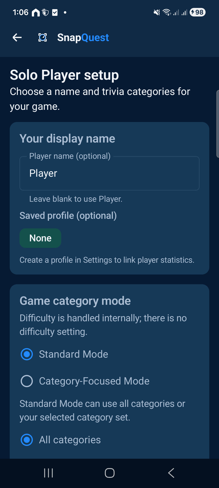
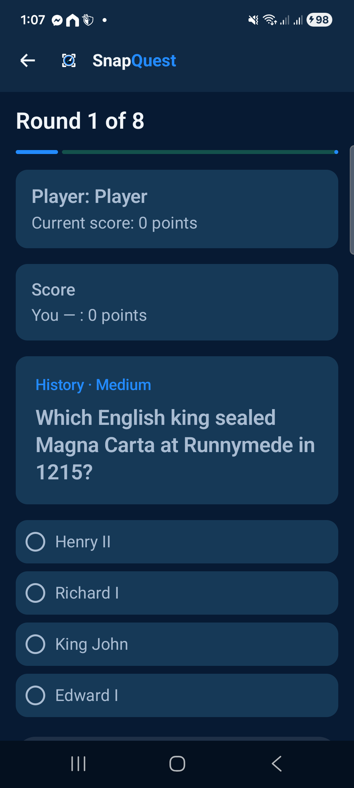
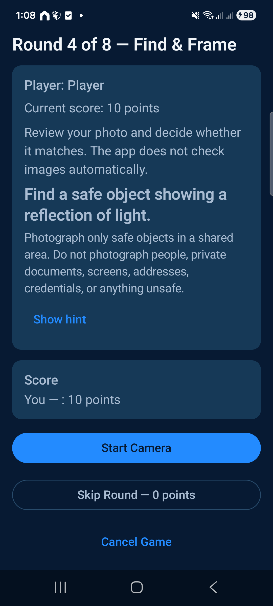
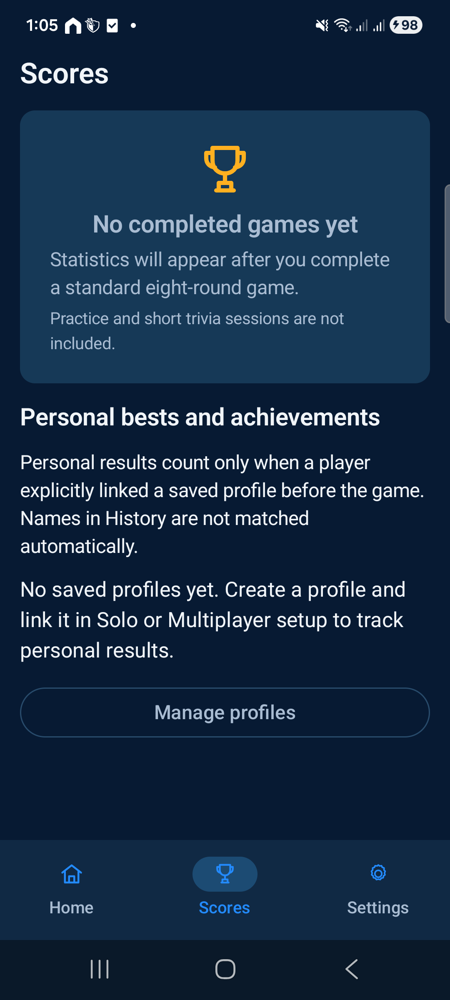

# SnapQuest

SnapQuest is an offline trivia and camera-challenge game for Android. Play a full game on your own or pass the device between friends, answer multiple-choice questions, and take turns completing Find & Frame prompts.

The project is built with Kotlin, Jetpack Compose, and Android's native development tools. It is designed for players who enjoy trivia and camera challenges, as well as students and developers interested in exploring an offline-first Android application.

Repository links: [Source Code](https://github.com/charlsbarquin/SnapQuest) · [Download SnapQuest](https://github.com/charlsbarquin/SnapQuest/releases/latest) · [All Releases](https://github.com/charlsbarquin/SnapQuest/releases) · [Report an Issue](https://github.com/charlsbarquin/SnapQuest/issues)

## Download SnapQuest

Download SnapQuest for Android from the official GitHub Releases page.

**[Download the Latest SnapQuest Release](https://github.com/charlsbarquin/SnapQuest/releases/latest)**

The latest published release verified for this repository is **SnapQuest v1.0.1**.

| APK detail | Verified value |
| --- | --- |
| Download | [`SnapQuest-v1.0.1.apk`](https://github.com/charlsbarquin/SnapQuest/releases/latest/download/SnapQuest-v1.0.1.apk) |
| Application version | `1.0.1` (version code `2`) |
| Package | `com.charlsemilbarquin.frameandfact` |
| Minimum Android | Android 8.0 Oreo / API 26 |
| File size | 15,450,615 bytes |
| SHA-256 | `B22881BD9B438F9CA66D97011738D228D2CEFD022A15403B1966A3AAFD8EC581` |
| Signing certificate SHA-256 | `c93364918db34f0a69ec167d4139fa497d72784cd348b7722a6632d35bbba437` |

The published v1.0.1 APK is signed with the original SnapQuest release key and was built from the source at its release tag. The preserved v1.0.0 APK is an earlier build. Gradle's standard release task still creates an unsigned APK; use Android Studio's signed APK workflow with the original key for future releases.

### Installation

1. Open the [SnapQuest Releases page](https://github.com/charlsbarquin/SnapQuest/releases/latest).
2. Open the latest published release.
3. Download the `.apk` file attached to that release.
4. Open the downloaded APK on your Android device.
5. If Android asks for permission to install apps from that source, open the relevant settings and allow installation.
6. Return to the installer and tap Install.
7. Open SnapQuest from your app launcher.

Only download the APK from the official repository or another source you trust.

### System Requirements

- Android 8.0 Oreo or later, API 26 or higher.
- Camera access when using Find & Frame challenges; camera hardware is optional because camera rounds can be skipped.
- Internet access to download the APK. Gameplay does not require an internet connection.
- Device-local account registration and sign-in are required to use the app; accounts are not synced to a server.

A camera is not required just to install the application. Players can skip camera rounds if their device lacks a camera or they do not wish to take a photo.

To update an existing installation, install a release signed with the same signing key and using a higher version code. Do not uninstall the existing app first unless you are prepared to lose locally stored game history and settings.

## Screenshots

These screenshots are existing project captures. The Home screenshot is omitted because it predates the current card-icon correction.

| Game Setup | Trivia Round |
| --- | --- |
|  |  |

| Find & Frame Prompt | Scores and Profiles |
| --- | --- |
|  |  |

## Features

- Full eight-round game in Solo or pass-and-play Multiplayer mode.
- 144 multiple-choice trivia questions across eight categories, with 18 questions per category and six at each internal difficulty level. Difficulty is handled internally, with no difficulty selector.
- 24 bundled Find & Frame prompts, with two camera rounds in each Full Game.
- Camera preview, photo capture, retake, accept, and reject controls.
- Player-based judging for camera submissions. SnapQuest does not automatically analyze photos to determine whether they match a prompt.
- Unscored Practice mode.
- Quick Trivia and Category Practice for shorter sessions.
- Completed-game history and incorrect-answer review.
- Local statistics and optional player profiles.
- Local question reports, rules and help, and an interactive tutorial.
- System, Light, and Dark appearance settings.
- Offline gameplay using bundled questions and camera prompts.
- Local storage for game history, settings, and related records.

## How to Play

A Full Game contains eight rounds.

| Round | Type |
| --- | --- |
| 1 | Trivia |
| 2 | Trivia |
| 3 | Trivia |
| 4 | Find & Frame |
| 5 | Trivia |
| 6 | Trivia |
| 7 | Trivia |
| 8 | Find & Frame |

Choose Solo or Multiplayer, then configure the participants and trivia categories.

During a trivia round, the assigned participant selects one of four answers.

During a Find & Frame round, the assigned player follows the camera prompt, captures a photo, reviews it, and submits it for judging. In Multiplayer, another participant acts as the judge. Camera prompts are selected independently of the chosen trivia categories. Camera rounds can also be skipped.

### Scoring

| Action | Points |
| --- | ---: |
| Correct trivia answer | 10 |
| Accepted camera submission | 10 |
| Incorrect trivia answer | 0 |
| Rejected camera submission | 0 |
| Skipped round | 0 |

The maximum Full Game score is 80 points.

There is no timer. Tied scores remain ties. Multiplayer trivia and camera rounds use separate turn rotations.

Practice is unscored. Quick Trivia and Category Practice are short sessions. Their results are kept separate from Full Game history and records.

## Requirements and Privacy

### Android Version

The minimum supported Android version is API 26, Android 8.0 Oreo, as configured by `minSdk`.

### Camera Permission

SnapQuest declares camera permission and requests access when camera functionality is used. Camera hardware is optional for installation. Players can skip camera rounds if they cannot or do not wish to capture a photo.

### Internet Access

The application manifest does not request the Android `INTERNET` permission. Trivia questions and camera prompts are bundled with the application.

Gameplay, history, preferences, reports, and account records use local app storage. Passwords are stored as salted PBKDF2 hashes; the local sign-in session identifier is encrypted with an Android Keystore key. Accounts are device-local and are not verified online or synced to a backend service. Game history, player profiles, statistics, and question reports are scoped to the signed-in local account. Existing records are preserved during the database migration and assigned to the oldest registered account; if there are no registered accounts, the first account to sign in claims the legacy records. Device settings remain local to the app installation.

Downloading the APK from GitHub requires an internet connection. Playing the game does not.

### Local Data Storage

- Room database version 7 stores local accounts, game history, player profiles, question reports, and Quick Trivia summaries. History, profiles, statistics, and reports are scoped to the signed-in local account. Migrations 1→2 through 6→7 are registered; migration 6→7 preserves legacy rows and assigns them to the oldest registered account, or leaves them available for the first account to claim when no account exists.
- Passwords are stored as per-account salted PBKDF2 hashes. The local session identifier is protected with Android Keystore encryption.
- Preferences DataStore stores app settings.
- Captured photos are held temporarily in the app's private cache.
- Temporary camera photos are deleted when the camera round ends or is canceled.
- Photos are not saved in game history.

## Architecture and Database

The app is a single Android module. Jetpack Compose screens are grouped by feature; the Kotlin game domain holds round setup, turn rotation, outcomes, and scoring; data repositories load the bundled JSON content and store local records; CameraX is used for the in-app Find & Frame preview and capture flow.

Room database version 7 exports its schema and registers the sequential migrations from versions 1 through 7. It stores local accounts, completed games and rounds, player profiles and achievements, question reports, and short-session summaries. Persistent game records are scoped to the signed-in local account. Settings are stored separately with Preferences DataStore. Statistics are derived from saved records rather than synced to a server.

### Backup and Data Removal

The configured Android backup and device-transfer rules exclude the Room database and settings file.

Uninstalling SnapQuest removes its locally stored app data. This can include game history, statistics, profiles, reports, and preferences.

There is currently no separate privacy policy file in the repository. If a privacy policy is required for a distribution platform, prepare and publish one based on the application's actual data practices.

## Technology Stack

- **Kotlin:** Application and game logic.
- **Jetpack Compose:** Declarative Android user interface.
- **Material 3:** Components and theming.
- **CameraX:** Camera preview and photo capture.
- **Room:** Local database and game history.
- **Preferences DataStore:** Local settings.
- **Gson:** Loading and validating bundled JSON content.
- **Gradle Kotlin DSL:** Build configuration.
- **Gradle Wrapper:** Reproducible Gradle command execution.
- **KSP:** Room code generation.

The checked-in build configuration specifies:

| Component | Configuration |
| --- | --- |
| Minimum SDK | 26 |
| Compile SDK | 37 |
| Target SDK | 37 |
| Kotlin | 2.2.10 |
| Android Gradle Plugin | 9.3.3 |
| Gradle | 9.5.0 |
| Java source/target compatibility | 11 |

Java source and target compatibility are not the same as the JDK used to run Gradle. Use an Android Studio and Gradle JDK setup compatible with the project's Android Gradle Plugin.

## Build from Source

### Prerequisites

- Android Studio compatible with the project's Android Gradle Plugin.
- Android SDK platform 37.
- A compatible Gradle JDK configured in Android Studio.
- A connected Android device or emulator running API 26 or later.

### Open the Project

1. Clone or download the [SnapQuest repository](https://github.com/charlsbarquin/SnapQuest).
2. Open the project directory in Android Studio.
3. Allow Gradle synchronization to finish.
4. Select a connected device or emulator.
5. Select the `app` run configuration and click Run.

### Run Tests

Open PowerShell in the cloned project root.

Run the local JVM unit tests:

```powershell
.\gradlew.bat :app:testDebugUnitTest
```

Compile Android instrumentation test sources without running them:

```powershell
.\gradlew.bat :app:compileDebugAndroidTestKotlin
```

Build the debug APK:

```powershell
.\gradlew.bat :app:assembleDebug
```

Run connected Android instrumentation tests:

```powershell
.\gradlew.bat :app:connectedDebugAndroidTest
```

Connected instrumentation requires an authorized Android device or emulator. Use a dedicated test device or isolated emulator: the debug test target may install the app package and must not be run over an installation whose data needs to be preserved.

### Debug APK Location

The debug APK is normally generated at:

```text
app/build/outputs/apk/debug/app-debug.apk
```

This is a development build. Use a signed release APK for public distribution.

### Signing a Release APK

The current Gradle release build is not configured with a signing key. Running `:app:assembleRelease` creates `app/build/outputs/apk/release/app-release-unsigned.apk`, which is for build verification and is not a user-downloadable release.

To create a distributable APK, use Android Studio's **Build > Generate Signed Bundle / APK** workflow with the original SnapQuest signing keystore. Select APK, the `app` module, and the release variant. Never generate a replacement key for app updates; Android requires the same signing certificate. Use a higher version code when publishing an update.

The release APK is generally saved under:

```text
app/build/outputs/apk/release/
```

The exact signed output location depends on the destination selected during APK generation. The repository currently retains `app/release/SnapQuest-v1.0.0.apk` as a previously signed build; it is not represented as rebuilt from the current working tree.

Keep the signing keystore and its passwords private. Do not commit them to the repository or attach them to a GitHub Release. Back up the keystore securely because future app updates should use the same signing key.

## Project Structure

```text
app/
  schemas/                         Room schema exports
  src/main/assets/content/         Bundled trivia and camera-prompt JSON
  src/main/java/.../domain/game/   Game models, rules, selection, and sessions
  src/main/java/.../data/content/  Content loading and validation
  src/main/java/.../data/auth/     Local authentication and protected sessions
  src/main/java/.../data/history/  Local history, reports, profiles, and statistics
  src/main/java/.../data/local/    Room entities, DAO, database, and migrations
  src/main/java/.../data/settings/ Preferences DataStore settings
  src/main/java/.../feature/       Compose screens and feature-specific UI/state
  src/main/java/.../ui/            Shared components, navigation, and theme
  src/test/                        Local JVM unit tests
  src/androidTest/                 Android instrumentation tests

design-review/                     Existing UI and device screenshots
gradle/
  libs.versions.toml               Dependency and plugin version catalog
  wrapper/                          Gradle wrapper configuration
```

## Testing and Verification

The project contains JVM unit tests and Android instrumentation tests for game rules, bundled content, history and migrations, settings, Compose screens, navigation recreation, and camera-related behavior.

Latest local verification, November 14, 2026:

- **119 JVM unit tests passed**, with no failures.
- Android instrumentation test sources compiled; this is compile verification, not an instrumentation test run.
- Debug and release APK assembly succeeded. The release output is unsigned.
- Android lint completed with **0 errors and 5 warnings**. The remaining notices report newer available versions of Android Gradle Plugin, Kotlin Compose plugin, Compose BOM, DataStore Preferences, and Gson; dependencies were not upgraded as part of this documentation task.
- The checked-in content contains 144 trivia questions and 24 camera prompts.
- The existing signed `app/release/SnapQuest-v1.0.0.apk` has a verified signature and was left unchanged. It is an existing prior build, not a newly built artifact from the current working tree.

Connected UI, migration, and instrumentation tests were not run during this verification. ADB could not start its server. The project owner has confirmed that physical camera functionality is already fixed and tested; this documentation task did not rerun the camera flow.

## Project Status

SnapQuest includes local account registration and sign-in, Solo and pass-and-play Multiplayer, trivia and Find & Frame rounds, practice modes, Room-backed history and account-scoped records, statistics, profiles, settings, and help/tutorial screens. The v1.0.1 source is pushed to `main`, and its signed APK is published on GitHub Releases. The preserved v1.0.0 APK remains an earlier build.

## Troubleshooting

### APK Will Not Install

- Confirm that the device runs Android 8.0 or later.
- Download the APK again from the official GitHub Releases page.
- Check whether Android requires permission to install apps from your browser or file manager.
- If updating an existing installation, confirm that the APK uses the same signing key as the installed version.

### Camera Does Not Open

- Check camera permission in Android settings.
- Return to SnapQuest and retry the camera round.
- If the device has no camera or you do not want to take a photo, skip the round.

### History or Settings Are Missing After Reinstallation

Uninstalling the app removes its locally stored app data. The configured backup rules exclude the database and settings file from backup and device transfer.

### Gradle Sync or Build Fails

- Confirm that Android SDK platform 37 is installed.
- Confirm that Android Studio uses a Gradle JDK compatible with the configured Android Gradle Plugin.
- Check that Gradle can access its configured distribution and dependencies.
- Review the first relevant error in Android Studio's Build output.

### A Camera Submission Is Rejected

Camera rounds are judged by players against the prompt. SnapQuest does not use automatic image recognition to determine whether a photo qualifies. Retake the photo if needed, and avoid capturing people or private information without their consent.

## Feedback and Bug Reports

Report bugs through the [SnapQuest Issues page](https://github.com/charlsbarquin/SnapQuest/issues), if Issues are enabled for the repository.

When reporting a problem, include:

- Device model.
- Android version.
- Steps to reproduce the issue.
- Expected behavior.
- Actual behavior.
- Relevant error messages, if available.

Do not attach private photos, documents, credentials, addresses, or other sensitive information.

## License, Contributions, and Credits

No `LICENSE` file is present. Until the project owner chooses and adds a license, do not assume that others have permission to reuse, modify, or redistribute this source code. The public repository has Issues and pull requests enabled for questions and proposed changes; submitting a change does not grant a license to the project or its assets.

The project uses third-party libraries identified in its Gradle version catalog and dependency declarations. Review each library's license before redistribution.

No separate external-asset credits file was identified in the previous documentation review. Add appropriate credits if the project includes external assets that require attribution.

## Publishing a Release

SnapQuest's source code is available at [charlsbarquin/SnapQuest](https://github.com/charlsbarquin/SnapQuest).

The current Gradle release build is unsigned. The published v1.0.1 APK was signed through Android Studio with the original release key. For future releases:

1. Build and test the intended source revision.
2. Sign the APK with the original signing key and verify its certificate.
3. Use a version tag that does not conflict with an existing tag or release.
4. Attach the signed APK and its SHA-256 checksum to the GitHub Release.
5. Publish the GitHub Release.
6. Verify the published release page and APK download, then confirm the latest-release link above resolves to it.

The latest-release link provides an APK only when a release with an APK asset has been published.

Never upload the release keystore, signing passwords, or other signing credentials to GitHub.
