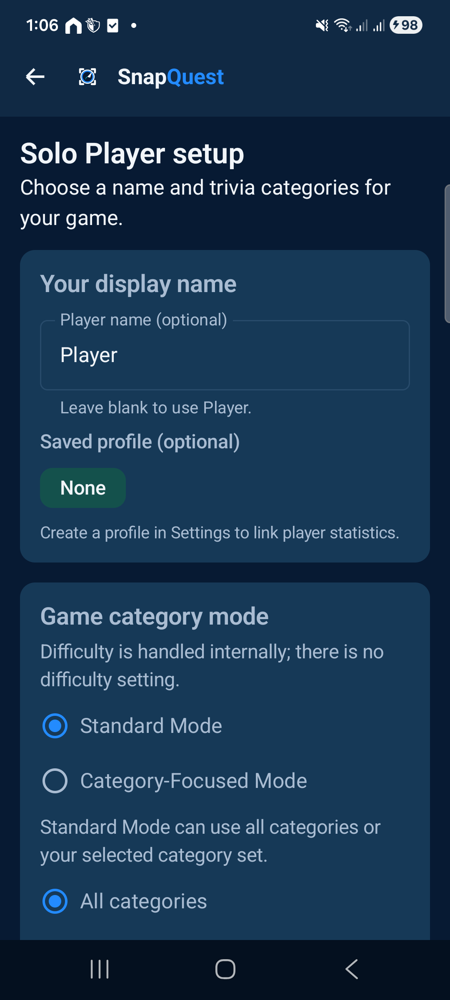
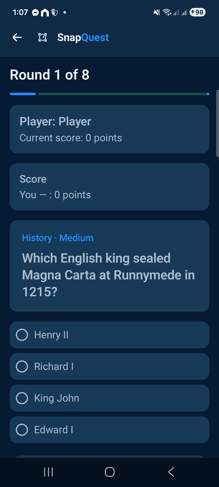
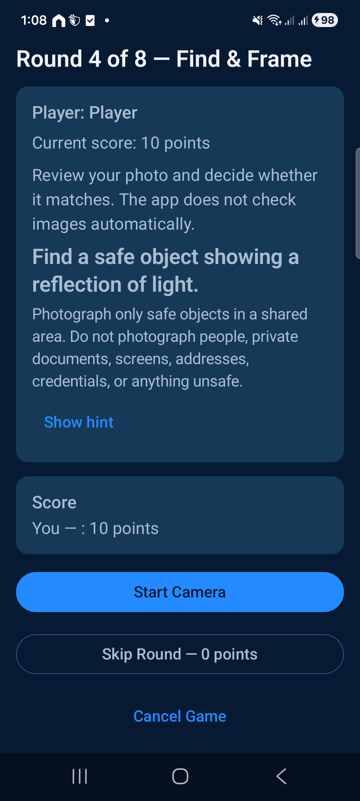
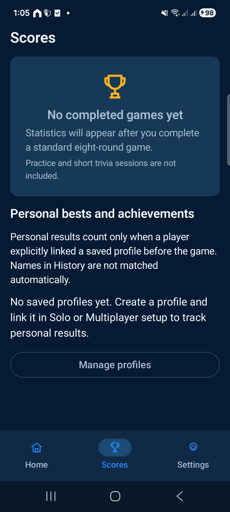

# SnapQuest

SnapQuest is an offline trivia and camera-challenge game for Android. Play a full game on your own or pass the device between friends, answer multiple-choice questions, and take turns completing Find & Frame prompts.

The project is built with Kotlin, Jetpack Compose, and Android's native development tools. It is designed for players who enjoy trivia and camera challenges, as well as students and developers interested in exploring an offline-first Android application.

Repository links: [Source Code](https://github.com/charlsbarquin/SnapQuest) · [Download SnapQuest](https://github.com/charlsbarquin/SnapQuest/releases/latest) · [All Releases](https://github.com/charlsbarquin/SnapQuest/releases) · [Report an Issue](https://github.com/charlsbarquin/SnapQuest/issues)

## Download SnapQuest

Download SnapQuest for Android from the official GitHub Releases page.

**[Download the Latest SnapQuest Release](https://github.com/charlsbarquin/SnapQuest/releases/latest)**

Open the latest release and download the attached `.apk` file.

The signed release APK has been generated locally. The public download becomes available after the APK is uploaded as a release asset and the GitHub Release is published.

### Installation

1. Open the [SnapQuest Releases page](https://github.com/charlsbarquin/SnapQuest/releases/latest).
2. Open the latest published release.
3. Download the `.apk` file attached to that release.
4. Open the downloaded APK on your Android device.
5. If Android asks for permission to install apps from that source, open the relevant settings and allow installation.
6. Return to the installer and tap Install.
7. Open SnapQuest from your app launcher.

Only download the APK from the official repository or another source you trust.

### System Requirements

- Android 8.0 Oreo or later, API 26 or higher.
- Camera access for Find & Frame challenges.
- Internet access to download the APK. Gameplay does not require an internet connection.

A camera is not required just to install the application. Players can skip camera rounds if their device lacks a camera or they do not wish to take a photo.

To update an existing installation, install a release signed with the same signing key and using a higher version code. Do not uninstall the existing app first unless you are prepared to lose locally stored game history and settings.

## Screenshots

These screenshots are existing project captures. The Home screenshot is omitted because it predates the current card-icon correction.

| Game Setup | Trivia Round |
| --- | --- |
|  |  |

| Find & Frame Prompt | Scores and Profiles |
| --- | --- |
|  |  |

## Features

- Full eight-round game in Solo or pass-and-play Multiplayer mode.
- 144 multiple-choice trivia questions across eight categories, with 18 questions per category and six at each internal difficulty level. Difficulty is handled internally, with no difficulty selector.
- 24 bundled Find & Frame prompts, with two camera rounds in each Full Game.
- Camera preview, photo capture, retake, accept, and reject controls.
- Player-based judging for camera submissions. SnapQuest does not automatically analyze photos to determine whether they match a prompt.
- Unscored Practice mode.
- Quick Trivia and Category Practice for shorter sessions.
- Completed-game history and incorrect-answer review.
- Local statistics and optional player profiles.
- Local question reports, rules and help, and an interactive tutorial.
- System, Light, and Dark appearance settings.
- Offline gameplay using bundled questions and camera prompts.
- Local storage for game history, settings, and related records.

## How to Play

A Full Game contains eight rounds.

| Round | Type |
| --- | --- |
| 1 | Trivia |
| 2 | Trivia |
| 3 | Trivia |
| 4 | Find & Frame |
| 5 | Trivia |
| 6 | Trivia |
| 7 | Trivia |
| 8 | Find & Frame |

Choose Solo or Multiplayer, then configure the participants and trivia categories.

During a trivia round, the assigned participant selects one of four answers.

During a Find & Frame round, the assigned player follows the camera prompt, captures a photo, reviews it, and submits it for judging. In Multiplayer, another participant acts as the judge. Camera prompts are selected independently of the chosen trivia categories. Camera rounds can also be skipped.

### Scoring

| Action | Points |
| --- | ---: |
| Correct trivia answer | 10 |
| Accepted camera submission | 10 |
| Incorrect trivia answer | 0 |
| Rejected camera submission | 0 |
| Skipped round | 0 |

The maximum Full Game score is 80 points.

There is no timer. Tied scores remain ties. Multiplayer trivia and camera rounds use separate turn rotations.

Practice is unscored. Quick Trivia and Category Practice are short sessions. Their results are kept separate from Full Game history and records.

## Requirements and Privacy

### Android Version

The minimum supported Android version is API 26, Android 8.0 Oreo, as configured by `minSdk`.

### Camera Permission

SnapQuest declares camera permission and requests access when camera functionality is used. Camera hardware is optional for installation. Players can skip camera rounds if they cannot or do not wish to capture a photo.

### Internet Access

The application manifest does not request the Android `INTERNET` permission. Trivia questions and camera prompts are bundled with the application.

Gameplay, history, preferences, and reports use local app storage. The project does not configure an account system or backend service.

Downloading the APK from GitHub requires an internet connection. Playing the game does not.

### Local Data Storage

- Room stores game history and related local records.
- Preferences DataStore stores app settings.
- Captured photos are held temporarily in the app's private cache.
- Temporary camera photos are deleted when the camera round ends or is canceled.
- Photos are not saved in game history.

### Backup and Data Removal

The configured Android backup and device-transfer rules exclude the Room database and settings file.

Uninstalling SnapQuest removes its locally stored app data. This can include game history, statistics, profiles, reports, and preferences.

There is currently no separate privacy policy file in the repository. If a privacy policy is required for a distribution platform, prepare and publish one based on the application's actual data practices.

## Technology Stack

- **Kotlin:** Application and game logic.
- **Jetpack Compose:** Declarative Android user interface.
- **Material 3:** Components and theming.
- **CameraX:** Camera preview and photo capture.
- **Room:** Local database and game history.
- **Preferences DataStore:** Local settings.
- **Gson:** Loading and validating bundled JSON content.
- **Gradle Kotlin DSL:** Build configuration.
- **Gradle Wrapper:** Reproducible Gradle command execution.
- **KSP:** Room code generation.

The checked-in build configuration specifies:

| Component | Configuration |
| --- | --- |
| Minimum SDK | 26 |
| Compile SDK | 37 |
| Target SDK | 37 |
| Kotlin | 2.2.10 |
| Android Gradle Plugin | 9.3.3 |
| Gradle | 9.5.0 |
| Java source/target compatibility | 11 |

Java source and target compatibility are not the same as the JDK used to run Gradle. Use an Android Studio and Gradle JDK setup compatible with the project's Android Gradle Plugin.

## Build from Source

### Prerequisites

- Android Studio compatible with the project's Android Gradle Plugin.
- Android SDK platform 37.
- A compatible Gradle JDK configured in Android Studio.
- A connected Android device or emulator running API 26 or later.

### Open the Project

1. Clone or download the [SnapQuest repository](https://github.com/charlsbarquin/SnapQuest).
2. Open the project directory in Android Studio.
3. Allow Gradle synchronization to finish.
4. Select a connected device or emulator.
5. Select the `app` run configuration and click Run.

### Run Tests

Open PowerShell in the project root:

`C:\Users\Asus\AndroidStudioProjects\FrameAndFact`

Run the local JVM unit tests:

```powershell
.\gradlew.bat testDebugUnitTest
```

Build the debug APK:

```powershell
.\gradlew.bat assembleDebug
```

Run connected Android instrumentation tests:

```powershell
.\gradlew.bat connectedDebugAndroidTest
```

The connected instrumentation command requires an authorized Android device or a configured emulator.

### Debug APK Location

The debug APK is normally generated at:

```text
app/build/outputs/apk/debug/app-debug.apk
```

This is a development build. Use a signed release APK for public distribution.

### Signed Release APK

The signed release APK is generated through Android Studio's **Build > Generate Signed Bundle / APK** workflow.

Choose APK, select the `app` module, select the release build variant, and use the configured release keystore.

The release APK is generally saved under:

```text
app/build/outputs/apk/release/
```

The exact output location depends on the destination selected during APK generation.

Keep the signing keystore and its passwords private. Do not commit them to the repository or attach them to a GitHub Release. Back up the keystore securely because future app updates should use the same signing key.

## Project Structure

```text
app/
  schemas/                         Room schema exports
  src/main/assets/content/         Bundled trivia and camera-prompt JSON
  src/main/java/.../domain/game/   Game models, rules, selection, and sessions
  src/main/java/.../data/content/  Content loading and validation
  src/main/java/.../data/history/  Local history, reports, profiles, and statistics
  src/main/java/.../data/local/    Room entities, DAO, database, and migrations
  src/main/java/.../data/settings/ Preferences DataStore settings
  src/main/java/.../feature/       Compose screens and feature-specific UI/state
  src/main/java/.../ui/            Shared components, navigation, and theme
  src/test/                        Local JVM unit tests
  src/androidTest/                 Android instrumentation tests

design-review/                     Existing UI and device screenshots
gradle/
  libs.versions.toml               Dependency and plugin version catalog
  wrapper/                          Gradle wrapper configuration
```

## Testing and Verification

The project contains JVM unit tests and Android instrumentation tests for game rules, bundled content, history and migrations, settings, Compose screens, navigation recreation, and camera-related behavior.

The latest recorded verification for the tested project build, dated November 2, 2026, was:

- **116 unit tests passed**, with no failures, errors, or skips.
- **43 connected instrumentation tests passed**, with no failures or skips, on a Samsung SM-A536B running Android API 36.
- Debug APK assembly completed successfully.
- The camera workflow was tested on a physical Android device.

These results describe the tested build. They do not guarantee that every device or Android version will behave identically. Run the test commands above against the current checkout to verify the current code.

A connected-device test run depends on ADB authorization and device availability.

## Troubleshooting

### APK Will Not Install

- Confirm that the device runs Android 8.0 or later.
- Download the APK again from the official GitHub Releases page.
- Check whether Android requires permission to install apps from your browser or file manager.
- If updating an existing installation, confirm that the APK uses the same signing key as the installed version.

### Camera Does Not Open

- Check camera permission in Android settings.
- Return to SnapQuest and retry the camera round.
- If the device has no camera or you do not want to take a photo, skip the round.

### History or Settings Are Missing After Reinstallation

Uninstalling the app removes its locally stored app data. The configured backup rules exclude the database and settings file from backup and device transfer.

### Gradle Sync or Build Fails

- Confirm that Android SDK platform 37 is installed.
- Confirm that Android Studio uses a Gradle JDK compatible with the configured Android Gradle Plugin.
- Check that Gradle can access its configured distribution and dependencies.
- Review the first relevant error in Android Studio's Build output.

### A Camera Submission Is Rejected

Camera rounds are judged by players against the prompt. SnapQuest does not use automatic image recognition to determine whether a photo qualifies. Retake the photo if needed, and avoid capturing people or private information without their consent.

## Feedback and Bug Reports

Report bugs through the [SnapQuest Issues page](https://github.com/charlsbarquin/SnapQuest/issues), if Issues are enabled for the repository.

When reporting a problem, include:

- Device model.
- Android version.
- Steps to reproduce the issue.
- Expected behavior.
- Actual behavior.
- Relevant error messages, if available.

Do not attach private photos, documents, credentials, addresses, or other sensitive information.

## License and Credits

No license file is currently documented in this repository. Until the project owner chooses and adds a license, do not assume that others have permission to reuse, modify, or redistribute this source code.

The project uses third-party libraries identified in its Gradle version catalog and dependency declarations. Review each library's license before redistribution.

No separate external-asset credits file was identified in the previous documentation review. Add appropriate credits if the project includes external assets that require attribution.

## Publishing a Release

SnapQuest's source code is available at [charlsbarquin/SnapQuest](https://github.com/charlsbarquin/SnapQuest).

A signed release APK has been generated locally. To make it publicly downloadable:

1. Confirm that the signed release APK installs and works on a physical Android device.
2. Open the [SnapQuest Releases page](https://github.com/charlsbarquin/SnapQuest/releases).
3. Create a new GitHub Release with a version tag, such as `v1.0.0`.
4. Attach the tested signed APK to the release.
5. Publish the release.
6. Open the published release page and verify that the APK downloads successfully.
7. Confirm that the download link at the beginning of this README points to the latest published release.

The release download link will provide an installable app only after a release containing the APK has been published.

Never upload the release keystore, signing passwords, or other signing credentials to GitHub.